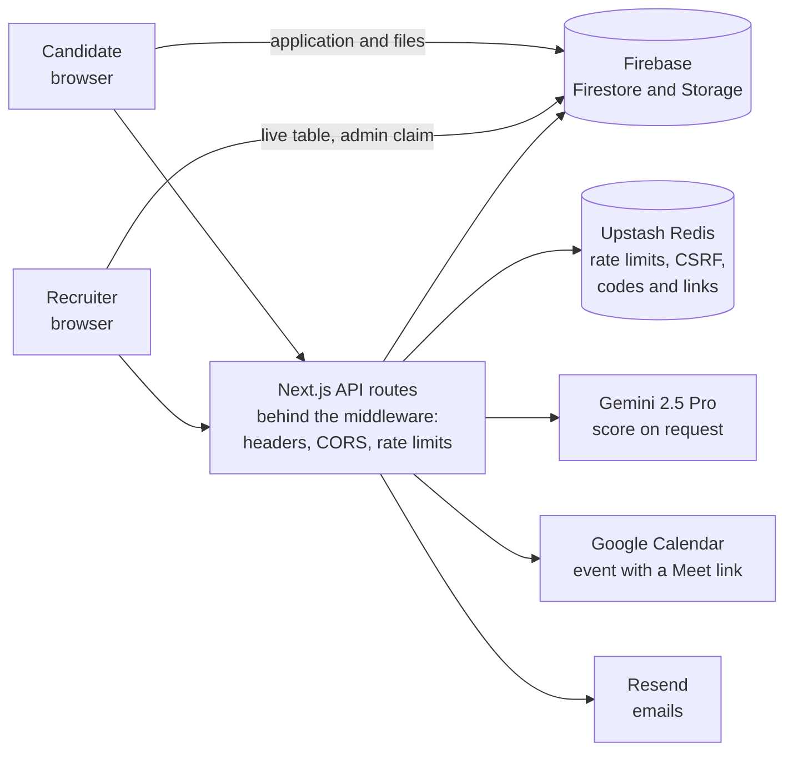

<div align="center">

<picture>
  <source media="(prefers-color-scheme: dark)" srcset="public/logo-skills-white.png">
  
</picture>

# Recruitment Portal

**A hiring system for international recruitment. Candidates apply and follow their applications. Recruiters review, score and interview them, in one place.**

[](https://nextjs.org/)
[](https://react.dev/)
[](https://www.typescriptlang.org/)
[](https://firebase.google.com/)
[](https://ai.google.dev/)
[](https://vercel.com/)

[What it does](#what-it-does) · [How it works](#how-it-works) · [Security](#security) · [Tech stack](#tech-stack) · [Run it](#run-it) · [Tests](#tests)

</div>

> [!NOTE]
> **Client work, state on 6 November 2026.** Built by Mohamed Yaakoubi for International Skills Labor Company (InternationalSkills.fi), a Finnish recruitment service that connects skilled international workers with European employers. Every feature below is in the code. Of the 513 unit tests, 502 pass. The 8 that fail were not updated after the code changed; see [Tests](#tests).

## What it does

| For | It lets them |
|---|---|
| **A candidate** | Apply for a job with a CV, a passport and a photo. Sign in with a link sent by email, without a password. Follow each application, see its AI score once there is one, and join the interview from its Google Meet link. |
| **A recruiter** | Sign in with a one-time code sent by email. Filter and sort every candidate, and open their documents. Ask Gemini for a score. Book, move or cancel interviews with a Meet link. Manage the job offers, read the charts and export the list. |

### For candidates

- **An application form in steps.** Personal details, a job chosen by category and speciality, and three uploads: CV, passport and photo. PDF, Word and image files are accepted, up to 10 MB each.
- **Checks before anything is saved.** The email address is checked: its format, a list of disposable domains, the domain's mail server, and Abstract API or Hunter.io when their keys are set. The phone number is checked with its country code, and a duplicate check looks for an earlier application from the same person. A hidden "honeypot" field catches simple bots: a person never fills it in, a bot often does.
- **Sign-in without a password.** The candidate asks for a link by email. The link works once and expires after 15 minutes. A signed session cookie then keeps the candidate signed in.
- **A personal dashboard.** Every application with its status (submitted, interview scheduled, approved or rejected), its AI score when there is one, and the date and Google Meet link of a booked interview.
- **Emails at each step.** Application received, interview booked, interview cancelled, application rejected, and the sign-in link. The templates are React components ([React Email](https://react.email)), sent with [Resend](https://resend.com).

### For recruiters

- **Sign-in with a one-time code.** Only the addresses in `ADMIN_EMAILS` can get a code. The 6-digit code expires after 5 minutes and allows 5 tries. The server then gives a Firebase token with an `admin` claim (a flag inside the token), and the database rules check that flag.
- **The candidate table.** Live from Firestore, with filters on several fields, sorting and pages. A profile window shows every document, and a form edits the candidate's details.
- **Status changes.** The recruiter moves a candidate to interview scheduled, approved or rejected. A booked interview and a rejection each send the matching email.
- **An AI score, only on request.** Gemini 2.5 Pro reads the CV and the profile, then gives a score from 0 to 100 on four weighted parts: how well the candidate meets the job's requirements (40%), the quality of their experience (30%), their skills (20%), and their growth potential and fit (10%). It also writes an analysis, the strengths, the points to improve and a recommendation.
- **Interviews with Google Meet.** A recruiter connects a Google account once. The app then creates the Google Calendar event with a Meet link and emails the candidate. An interview can be moved or cancelled, and a calendar view shows all of them.
- **Job offers.** Create, edit, turn on or off, and delete.
- **Charts and export.** Charts of the statuses and the scores, and an export of the list to CSV, XLSX or JSON.
- **A light and a dark theme.**

## What the AI may and may not do

Gemini gives a score and a written opinion, and only when a recruiter asks for one. It does not change a status, reject anyone or send an email. A person makes every decision.

## How it works



1. **Apply.** The candidate's browser checks each field and reads the first bytes of each file to confirm its real type. The server checks the email address and the phone number. The browser then uploads the files to Firebase Storage and creates the application in Firestore. The rules let anyone create an application, but only a recruiter can read it.
2. **Confirm.** The candidate gets an email that confirms the application.
3. **Review.** A recruiter signs in with a code, and the application appears in the table at once.
4. **Score, if asked.** Gemini reads the CV and the profile and returns a score and an opinion. Nothing else changes.
5. **Interview.** The recruiter books a time. The app creates the Google Calendar event with a Meet link and emails the candidate, whose dashboard shows the date and the link.
6. **Decide.** The recruiter sets the final status. A rejection sends an email.

## Security

| Layer | What it does |
|---|---|
| **Rate limits** | The middleware limits each visitor on each route. The counters live in Upstash Redis, so a limit holds across all server instances. In production: 3 sign-in codes per 10 minutes, 5 sign-in links per 10 minutes, and 30 requests a minute by default. |
| **CSRF tokens** | CSRF is a trick where another website sends a request with the visitor's cookies. The 7 recruiter routes that change data (jobs, statuses, edits, scores, interviews, export) need a CSRF token. The secrets live in Redis for 15 minutes, so any server instance can check them. |
| **Origin check** | The recruiter sign-in routes, the duplicate check and the confirmation email accept requests only from the app's own address. |
| **Security headers** | A Content Security Policy, HSTS, `X-Frame-Options: DENY`, `nosniff`, a referrer policy and a permissions policy, on every response. |
| **Input** | 16 of the 25 API routes check their input with Zod schemas. sanitize-html cleans the text that goes into emails. |
| **Uploads** | The form reads the first bytes of each file to confirm its real type, not only its name. The storage rules accept only PDF, Word and image files of 10 MB or less. |
| **Database rules** | Anyone can create an application and read the job offers. Only a token with the `admin` claim can read, change or delete candidates, or change the job offers. |
| **Stored secrets** | Google tokens are encrypted with AES-256-GCM before they are saved. Sign-in codes and links are saved only as SHA-256 hashes, and codes are compared in constant time. |
| **Monitoring** | Security events go to a structured log. Serious ones can alert a Slack channel, a webhook or an email address. |
| **Configuration** | The server checks the required environment variables when it starts. |

## Tech stack

| Part | Built with | Why |
|---|---|---|
| App | Next.js 15 (App Router), React 18, TypeScript 5 | The pages and the API live in one codebase, and each API route runs as a serverless function. |
| Look | Tailwind CSS 3, Headless UI, Lucide icons, next-themes | Utility classes for the layout, accessible menus and dialogs, and the light and dark themes. |
| Charts and calendar | Recharts, React Big Calendar | The dashboard's charts and the interview calendar. |
| Data | Firebase Firestore, Storage and Auth, with the Firebase Admin SDK on the server | A live database for the table, storage for the documents, and custom tokens for the recruiters. Firestore is set to the `eur3` location, in Europe. |
| Client cache | TanStack Query | Keeps server data cached and fresh in the browser. |
| Shared state | Upstash Redis, @upstash/ratelimit | Serverless calls share no memory, so rate limits, CSRF secrets, codes and links must live outside them. |
| AI | Gemini 2.5 Pro, through @google/generative-ai and @google/genai | Reads the CV files and the profile, and returns the score as JSON. |
| Interviews | Google Calendar API (googleapis), with OAuth | Creates the event and its Meet link in the recruiter's own calendar. |
| Email | Resend, React Email | Six templates written as React components, sent through one API. |
| Validation | Zod 4, sanitize-html | Schemas for the API input, and clean text in emails. |
| Export | SheetJS (xlsx) | The XLSX export. |
| Tests | Vitest, Testing Library, jsdom, the Firebase emulators, Playwright | Unit tests, integration tests against local copies of Firebase, and end-to-end tests in a real browser. |
| Quality | ESLint in strict mode, Prettier, Husky, lint-staged | Lints and formats the changed files before every commit. |
| Hosting | Vercel | The app, plus a daily cron that keeps the free Upstash database active. |

## Run it

You need Node.js 20 or newer and pnpm 10. For the integration tests, you also need the Firebase CLI and Java, which its Firestore emulator runs on.

```bash
pnpm install
# create .env.local with the values below (it is never committed)
pnpm dev
```

The app opens at http://localhost:3000, and the recruiter sign-in at http://localhost:3000/admin-dashboard-secret/login.

### The setup steps

Each value goes into `.env.local` for local work, and into the project settings on Vercel. Never into the code.

| Step | Variables | Where it comes from |
|---|---|---|
| 1 | `FIREBASE_PROJECT_ID`, `FIREBASE_CLIENT_EMAIL`, `FIREBASE_PRIVATE_KEY` | Firebase console, Project settings, Service accounts, "Generate new private key". Only the server uses them. Keep the key on one line, with `\n` for each line break. |
| 2 | `NEXT_PUBLIC_FIREBASE_API_KEY`, `NEXT_PUBLIC_FIREBASE_AUTH_DOMAIN`, `NEXT_PUBLIC_FIREBASE_PROJECT_ID`, `NEXT_PUBLIC_FIREBASE_STORAGE_BUCKET`, `NEXT_PUBLIC_FIREBASE_MESSAGING_SENDER_ID`, `NEXT_PUBLIC_FIREBASE_APP_ID`, `NEXT_PUBLIC_FIREBASE_MEASUREMENT_ID` | Firebase console, Project settings, Your apps, the web app's config. These values reach the browser by design, and the rules protect the data. In Google Cloud, limit this API key to the Firebase APIs. |
| 3 | `ADMIN_EMAILS` | The addresses that may sign in to the recruiter dashboard, separated by commas. |
| | `NEXT_PUBLIC_DEFAULT_ADMIN_EMAIL`, `FALLBACK_ADMIN_EMAIL` | The recruiter address that the interview form fills in, and the one that the server adds to an event when none is given. |
| 4 | `UPSTASH_REDIS_REST_URL`, `UPSTASH_REDIS_REST_TOKEN` | A Redis database at [upstash.com](https://upstash.com), from its REST API section. |
| | `REDIS_KEEPALIVE_SECRET` | Optional. Any long random text. When it is set, the daily keep-alive route asks for it. |
| 5 | `TOKEN_ENCRYPTION_KEY`, `CANDIDATE_SESSION_SECRET` | Two long random values, for example from `openssl rand -hex 32`. The first encrypts the Google tokens. The second signs the candidate session cookie. |
| 6 | `RESEND_API_KEY`, `RESEND_FROM_EMAIL` | [resend.com](https://resend.com), with a verified sending domain. |
| 7 | `GEMINI_API_KEY` | [Google AI Studio](https://aistudio.google.com). |
| 8 | `GOOGLE_CLIENT_ID`, `GOOGLE_CLIENT_SECRET`, `GOOGLE_REDIRECT_URI` | Google Cloud console: turn on the Google Calendar API, then create an OAuth client of the type "Web application". The redirect URI is the app's address followed by `/api/google-auth/callback`. |
| 9 | `ABSTRACT_API_KEY`, `ABSTRACT_PHONE_API_KEY`, `HUNTER_API_KEY` | Optional. [Abstract API](https://www.abstractapi.com) for email and phone validation, and [Hunter](https://hunter.io). Without them, the email check still covers the format, the disposable domains and the mail server. |
| 10 | `COMPANY_NAME`, `SUPPORT_EMAIL`, `CONTACT_PHONE`, and the same three with the prefix `NEXT_PUBLIC_` | The organisation's name and contacts, shown on the pages and in the emails. |
| 11 | `NEXT_PUBLIC_APP_URL`, `NEXT_PUBLIC_BASE_URL` | The public address of the app, used for the links in emails. |
| 12 | `SECURITY_ALERT_SLACK_WEBHOOK`, `SECURITY_ALERT_WEBHOOK_URL`, `SECURITY_ALERT_EMAIL` | Optional. Where serious security events are sent. |

### The commands

| Command | What it does |
|---|---|
| `pnpm dev` | Starts the app at http://localhost:3000, with Turbopack. |
| `pnpm build`, then `pnpm start` | Builds the production version, then serves it. |
| `pnpm lint` | Runs ESLint on `src`. |
| `pnpm format`, `pnpm format:check` | Prettier: rewrites the files, or only checks them. |
| `pnpm vitest run` | Runs the unit tests once. `pnpm test` keeps them running while you work, and `pnpm test:ui` shows them in a browser. |
| `pnpm test:integration:run` | Starts the Firebase emulators, runs the integration tests against them, then stops them. |
| `pnpm test:e2e` | Starts the app and runs the Playwright tests. `pnpm test:e2e:ui` opens Playwright's window. |
| `pnpm emulators` | Starts local copies of Firebase Auth (port 9099), Firestore (8080) and Storage (9199), with their UI on port 4000. |
| `pnpm reset-db:confirm` | **Deletes every candidate and every job** in the Firebase project of your environment, after you type `YES`. There is no undo. |

## Tests

| Kind | Where | How many | State on 6 November 2026 |
|---|---|---|---|
| Unit | `src/**/__tests__` | 513 tests in 99 files | 502 pass, 8 fail, 3 are skipped |
| Integration | `src/__integration__` | 4 files | Not run for this README. They need the Firebase emulators. |
| End to end | `e2e/` | 23 Playwright files | Not run for this README. |

The 8 failures come from tests that were not updated after the code changed in April 2026. The recruiter sign-in moved from a password to a one-time code, so `useAuth.test.tsx` (3 tests) still calls a password sign-in that no longer exists. The candidate header started to read the page address, and the mock in `DashboardHeader.test.tsx` (4 tests) does not provide it. `useCandidateDashboard.test.ts` (1 test) has the same kind of out-of-date mock.

## Project structure

```text
src/
  app/                  pages: home, candidate choices, application form, candidate dashboard, recruiter dashboard
    api/                25 API routes: sign-in, candidates, jobs, scoring, interviews, export, health
    components/         the interface, one folder per feature
  components/emails/    the 6 email templates
  hooks/                React hooks, one per feature
  lib/                  security (CSRF, rate limits, origin check, encryption), Firebase, logging, validation
  services/             the logic: candidates, jobs, scoring, interviews, email, codes, links
  middleware.ts         security headers, CORS and rate limits on every request
  instrumentation.ts    checks the environment when the server starts
e2e/                    Playwright tests
scripts/                maintenance scripts
firestore.rules         database rules
storage.rules           file storage rules
vercel.json             the daily cron
```

## Deploy

1. Import the repository in Vercel, and add every variable of the setup steps in the project settings.
2. Publish the rules and the indexes: `firebase deploy --only firestore:rules,firestore:indexes,storage`.
3. In Google Cloud, add the deployed address followed by `/api/google-auth/callback` to the redirect URIs of the OAuth client.
4. `vercel.json` calls `/api/redis-keepalive` every day at 00:00 UTC, so that Upstash does not archive the free database. If you set `REDIS_KEEPALIVE_SECRET`, give `CRON_SECRET` the same value: Vercel sends `CRON_SECRET` as the Bearer token of its cron calls.

## Author

Built by **Mohamed Yaakoubi**: [mohamedyaakoubi.com](https://mohamedyaakoubi.com) · [GitHub](https://github.com/mohamedyaakoubi)

## Licence

This is client work, and no licence is given to use, copy or share the code.
